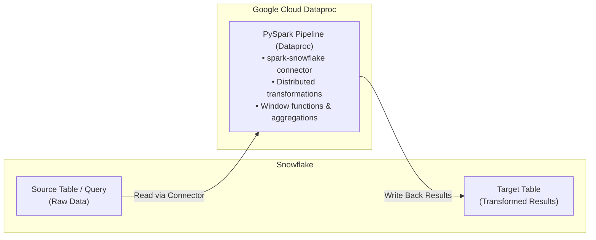

# Proof of Concept: Running Snowflake Compute Pipelines on Google Cloud Dataproc

This Proof of Concept (POC) provides everything needed to deploy, run, and test heavy data transformation pipelines on **Google Cloud Dataproc (Apache Spark)** using data from **Snowflake**.

Instead of executing large analytical transformations or ETL jobs inside expensive Snowflake Virtual Warehouses, this pipeline uses the official **Snowflake Spark Connector** to read source data, execute distributed PySpark transformations on Dataproc compute, and write the curated results back into Snowflake (or Google Cloud Storage / BigQuery).

---

## 1. Architecture



* **Snowflake Virtual Warehouse**: Only spins up briefly during the initial read/write stage.
* **Dataproc Cluster**: Handles 100% of the heavy data manipulation, window functions, and aggregations using scalable PySpark compute.

---

## 2. Repository Structure

```text
dataproc-vs-snowflake-poc/
├── README.md                           # Customer setup and testing guide (this file)
├── terraform/                          # Infrastructure-as-Code for GCP environment
│   ├── main.tf                         # Provisions GCS bucket, IAM service account & Dataproc cluster
│   ├── variables.tf                    # Cluster sizing, region, and GCP project variables
│   ├── outputs.tf                      # Output resource names and sample submission commands
│   └── terraform.tfvars.example        # Configuration template
└── pyspark/                            # Distributed PySpark pipeline
    └── snowflake_dataproc_pipeline.py  # Production script connecting to Snowflake, transforming, & writing back
```

---

## 3. Quick Start Guide

### Step 1: Deploy Dataproc Infrastructure with Terraform

1. Navigate to the `terraform/` directory:
   ```bash
   cd dataproc-vs-snowflake-poc/terraform
   ```

2. Copy the example variable configuration:
   ```bash
   cp terraform.tfvars.example terraform.tfvars
   ```
   Edit `terraform.tfvars` and set your active GCP project ID (e.g., `gemini-in-bq-2`):
   ```hcl
   project_id   = "YOUR_GCP_PROJECT_ID"
   region       = "us-central1"
   cluster_name = "dataproc-snowflake-poc"
   ```

3. Deploy the cluster and staging storage:
   ```bash
   terraform init
   terraform apply -auto-approve
   ```

> **Automatic Cost Safeguard**: The cluster is configured with `idle_delete_ttl = "1800s"`. If no jobs are running for 30 minutes, the cluster automatically terminates itself to prevent unintended spend during testing.

---

### Step 2: Test the Pipeline

You have two options for testing:

#### Option A: Quick Validation Run (No Snowflake Credentials Needed)
Validate the cluster setup and transformation logic using self-generated test data (1,000,000 records):

```bash
gcloud dataproc jobs submit pyspark \
  gs://YOUR_BUCKET_NAME/scripts/snowflake_dataproc_pipeline.py \
  --cluster=dataproc-snowflake-poc \
  --region=us-central1 \
  -- \
  --test_mode \
  --test_rows 1000000 \
  --output_gcs_path gs://YOUR_BUCKET_NAME/output/test_run/
```

#### Option B: Live Snowflake Pipeline Run
Connect directly to your Snowflake environment to read a table, run the transformation on Dataproc, and write the output back to Snowflake.

Use the auth method that matches your Snowflake environment. For enterprise workloads, a dedicated Snowflake service user is preferred over a human username/password.

##### B1. Standard password auth (demo / quick validation)

```bash
# 1. Set your Snowflake password in your local shell
export SNOWFLAKE_PASSWORD="YOUR_SNOWFLAKE_PASSWORD"

# 2. Submit the job with the official Snowflake Spark Connector packages
gcloud dataproc jobs submit pyspark \
  gs://YOUR_BUCKET_NAME/scripts/snowflake_dataproc_pipeline.py \
  --cluster=dataproc-snowflake-poc \
  --region=us-central1 \
  --packages=net.snowflake:spark-snowflake_2.12:2.16.0-spark_3.4,net.snowflake:snowflake-jdbc:3.16.0 \
  -- \
  --sf_auth_mode password \
  --sf_password "$SNOWFLAKE_PASSWORD" \
  --sf_url "YOUR_ACCOUNT.snowflakecomputing.com" \
  --sf_user "YOUR_USERNAME" \
  --sf_database "YOUR_DATABASE" \
  --sf_schema "YOUR_SCHEMA" \
  --sf_warehouse "YOUR_WAREHOUSE" \
  --sf_source_table "YOUR_SOURCE_TABLE" \
  --sf_target_table "YOUR_TARGET_TABLE" \
  --write_mode "overwrite"
```

##### B2. Enterprise key-pair auth (preferred for service users)

For enterprise accounts, the Dataproc job authenticates as a Snowflake service user using a PKCS#8 private key (`.p8`). Credentials do **not** need to be stored permanently in GCP: passing `--files` stages the key file ephemerally for the single job execution, and the pipeline automatically formats the key into `pem_private_key` (and decrypts it in-memory if a passphrase is provided).

```bash
gcloud dataproc jobs submit pyspark \
  gs://YOUR_BUCKET_NAME/scripts/snowflake_dataproc_pipeline.py \
  --cluster=dataproc-snowflake-poc \
  --region=us-central1 \
  --packages=net.snowflake:spark-snowflake_2.12:2.16.0-spark_3.4,net.snowflake:snowflake-jdbc:3.16.0 \
  --files="/tmp/snowflake_service_user_key.p8" \
  -- \
  --sf_auth_mode keypair \
  --sf_private_key_path "snowflake_service_user_key.p8" \
  --sf_url "YOUR_ACCOUNT.snowflakecomputing.com" \
  --sf_user "svc_dataproc_user" \
  --sf_database "YOUR_DATABASE" \
  --sf_schema "PUBLIC" \
  --sf_warehouse "YOUR_WAREHOUSE" \
  --sf_role "MY_ROLE" \
  --sf_source_table "YOUR_SOURCE_TABLE" \
  --sf_target_table "YOUR_TARGET_TABLE" \
  --write_mode "overwrite"
```

*(Optional: if your `.p8` key is encrypted with a passphrase, append `--sf_private_key_passphrase "$SNOWFLAKE_PRIVATE_KEY_PASSPHRASE"` after `--`.)*

##### B3. OAuth / federated auth

If your enterprise Snowflake deployment uses OAuth or a federated token flow, pass the token instead of a password:

```bash
export SNOWFLAKE_OAUTH_TOKEN="YOUR_OAUTH_TOKEN"

gcloud dataproc jobs submit pyspark \
  gs://YOUR_BUCKET_NAME/scripts/snowflake_dataproc_pipeline.py \
  --cluster=dataproc-snowflake-poc \
  --region=us-central1 \
  --packages=net.snowflake:spark-snowflake_2.12:2.16.0-spark_3.4,net.snowflake:snowflake-jdbc:3.16.0 \
  -- \
  --sf_auth_mode oauth \
  --sf_oauth_token "$SNOWFLAKE_OAUTH_TOKEN" \
  --sf_url "YOUR_ACCOUNT.snowflakecomputing.com" \
  --sf_user "svc_dataproc_user" \
  --sf_database "YOUR_DATABASE" \
  --sf_schema "PUBLIC" \
  --sf_warehouse "YOUR_WAREHOUSE" \
  --sf_source_table "YOUR_SOURCE_TABLE" \
  --sf_target_table "YOUR_TARGET_TABLE" \
  --write_mode "overwrite"
```

*Note: You can also specify `--sf_source_query "SELECT ... FROM ... WHERE ..."` instead of reading an entire table.*

> Enterprise guidance: the Dataproc job authenticates to Snowflake as a Snowflake identity. In a production enterprise setup, that identity should usually be a dedicated service user or federated service principal, not a human username/password combination.

---

## 4. Customizing Your Business Logic

The script [`pyspark/snowflake_dataproc_pipeline.py`](pyspark/snowflake_dataproc_pipeline.py) contains a dedicated function:

```python
def apply_transformations(df: DataFrame) -> DataFrame:
    """Execute customer business logic & data transformations on Dataproc compute."""
    # Add your custom PySpark joins, windowing, filtering, or aggregations here
    return transformed_df
```

To test your specific transformation logic:
1. Update `apply_transformations()` with your pipeline's calculations.
2. Upload the updated script to your GCS bucket:
   ```bash
   gsutil cp pyspark/snowflake_dataproc_pipeline.py gs://YOUR_BUCKET_NAME/scripts/
   ```
3. Re-submit the job.

---

## 5. How to Compare Metrics After Testing

Once you have run the pipeline, compare the actual performance and resource consumption between the two platforms:

### 1. Retrieve Dataproc Execution Telemetry
At the end of the Dataproc job output, the script prints:
* **Total Pipeline Runtime** (elapsed seconds / minutes)
* **Transformation Wall Time**
* **Input and Output Row Counts**

You can also view detailed CPU, memory, and executor metrics in the **Dataproc Jobs UI** in the Google Cloud Console.

### 2. Retrieve Snowflake Query & Warehouse Telemetry
In your Snowflake worksheet, run this query to view how long the query took and how many credits were consumed when executing on Snowflake compute:

```sql
SELECT
    query_id,
    warehouse_name,
    warehouse_size,
    total_elapsed_time / 1000.0 AS execution_time_seconds,
    (total_elapsed_time / 1000.0) / 60.0 AS execution_time_minutes,
    credits_used_cloud_services,
    query_text
FROM TABLE(information_schema.query_history(
    date_range_start => DATEADD(hours, -2, CURRENT_TIMESTAMP())
))
WHERE query_text ILIKE '%YOUR_TABLE_OR_QUERY%'
ORDER BY start_time DESC
LIMIT 5;
```

To see total warehouse credit burn during the test window:
```sql
SELECT
    warehouse_name,
    SUM(credits_used) AS total_credits_consumed
FROM snowflake.account_usage.warehouse_metering_history
WHERE start_time >= DATEADD(hours, -2, CURRENT_TIMESTAMP())
  AND warehouse_name = 'YOUR_WAREHOUSE'
GROUP BY warehouse_name;
```

### 3. Comparison Scorecard Template

| Metric | Snowflake Virtual Warehouse | Google Cloud Dataproc |
| :--- | :--- | :--- |
| **Compute Tier** | e.g. Large Warehouse | 1 Master + 2 Primary + 4 Spot Workers (28 vCPUs) |
| **Execution Wall Time** | `___` minutes | `___` minutes |
| **Compute Units Billed** | `___` Snowflake Credits | `___` vCPU-hours |
| **Your Contract Unit Rate**| \$`___` / credit | \$`___` / vCPU-hour |
| **Total Test Run Cost** | **\$`___`** | **\$`___`** |

---

## 6. Teardown / Cleanup

When testing is complete, destroy all cloud resources with Terraform:

```bash
cd dataproc-vs-snowflake-poc/terraform
terraform destroy -auto-approve
```
